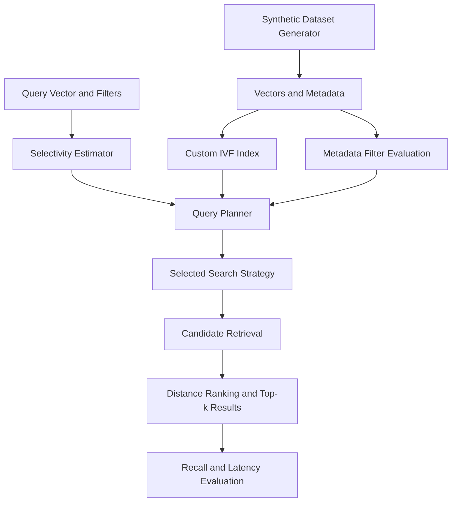

# The Madurai Pincode Search

## 1. Problem Summary

The Madurai Pincode Search project explores filtered vector search over a synthetic marketplace dataset containing vector embeddings and metadata.

The goal is to retrieve the nearest matching vectors while supporting metadata filters and balancing search quality with query latency.

The implementation supports these filters:

- Category equality
- Delivery-zone equality
- Minimum and maximum price conditions
- Combinations of filters using AND logic

The project uses a custom Inverted File (IVF)-style vector index and a query planner that selects a search strategy based on estimated filter selectivity.

The evaluation compares the planner with pre-filter and post-filter baselines using recall@10 and latency measurements across different filter-selectivity buckets.

## 2. Architecture

The architecture consists of five main stages:

1. **Dataset generation:** Creates synthetic vectors and metadata using a fixed random seed.
2. **Index construction:** Organizes vectors into IVF-style partitions.
3. **Filter estimation:** Estimates how many records will match the requested metadata conditions.
4. **Query planning and retrieval:** Selects a search strategy and retrieves candidate vectors.
5. **Evaluation:** Ranks results by vector distance and measures recall and latency.

The diagram source is shown below. Export it as `docs/architecture.png` and ensure the image is included in the GitHub repository before submission.




The planner uses the estimated selectivity to choose a search path. The chosen strategy applies metadata filtering and retrieves candidates, after which the results are ranked by vector distance. The benchmark compares the resulting recall and latency with the baseline methods.

## 3. Requirements and Setup

### Environment

The project was developed and tested in the following environment:

- Operating system: Windows
- Python: 3.13.11
- Git: 2.52.0.windows.1
- Numerical computation: NumPy

### Installation

Open PowerShell and navigate to the repository directory:

```powershell
cd path\to\horrazon-filtered-vector-search
```

Create and activate a virtual environment:

```powershell
python -m venv .venv
.\.venv\Scripts\Activate.ps1
python -m pip install --upgrade pip
```

Install the project dependencies. If the repository contains `requirements.txt`, run:

```powershell
python -m pip install -r requirements.txt
```

If a dependency file is not present, install the dependencies specified by the project instead. Confirm the required dependencies from the repository before submitting.

Run the tests to check the installation:

```powershell
python -m pytest -q
```

The recorded test run completed with **4 passing tests**.

## 4. Dataset

The project uses a synthetic dataset generated with a fixed random seed.

| Property | Value |
|---|---:|
| Original records | 30,000 |
| Vector dimensions | 32 |
| Categories | 20 |
| Delivery zones | Approximately 30 |
| Random seed | `20261023` |

Each record contains a vector and associated metadata. The generator introduces nonuniform distributions and relationships between some metadata fields and vector groups.

Prices are generated synthetically using category-dependent distributions. The fixed seed makes the original dataset reproducible when the same generation procedure and dependencies are used.

The dataset is intended to evaluate search behavior under different filter selectivities. It is synthetic and should not be treated as representative of every real-world marketplace workload.

## 5. Running the Project

Run these commands from the repository root:

### Run the demonstration

```powershell
python main.py demo
```

### Run the benchmark

```powershell
python main.py benchmark
```

### Run the mutation experiment

```powershell
python main.py mutation
```

### Run automated tests

```powershell
python -m pytest -q
```

The demo exercises the search workflow. The benchmark compares the planner with the baseline methods, while the mutation experiment evaluates behavior after the configured dataset changes.

Benchmark and mutation results are saved under the `results` directory, according to the current implementation.

## 6. Index and Query Planner

### Custom IVF-style index

The implementation organizes vectors into partitions around cluster centers. Instead of always comparing a query against every vector, the search process can examine selected partitions to retrieve candidate vectors.

The number of partitions examined affects the trade-off between retrieval cost and recall. Searching more partitions can improve the chance of finding the exact nearest neighbors but may increase the work performed per query.

### Search strategies

**Exact filtered search — `exact_filtered`**

Applies the metadata filters and performs exact distance ranking over the eligible records. This is intended for queries where the matching subset is sufficiently small.

**Partition prefilter — `partition_prefilter`**

Uses metadata filtering and eligible partitions to narrow the search space before ranking candidate vectors.

**IVF postfilter — `ivf_postfilter`**

Retrieves candidates from IVF partitions and applies the metadata filters to those candidates. Its effectiveness depends on the number and quality of candidates retrieved.

**Post-filter baseline — `postfilter`**

Retrieves vector candidates before applying metadata filters. This provides a comparison for filtering after candidate retrieval.

**Pre-filter baseline — `prefilter`**

Restricts the eligible records using metadata filters before vector ranking. This provides a comparison for filtering before ranking.

### Selectivity estimation

The selectivity estimator combines marginal selectivity estimates for the supported metadata predicates. The resulting estimate is used by the planner to choose a search strategy.

The configured thresholds are:

| Estimated selectivity | Selected strategy |
|---|---|
| At or below `0.002` | `exact_filtered` |
| Greater than `0.002` and at or below `0.08` | `partition_prefilter` |
| Greater than `0.08` | `ivf_postfilter` |

These thresholds are specific to this implementation and workload. They are not universal optimal values. Their effectiveness must be assessed using measured performance.

A limitation of multiplying marginal estimates is that the result can be inaccurate when metadata fields are correlated. For example, category and delivery zone may not be independent, so the estimated selectivity may differ from the actual proportion of matching records.

## 7. Benchmark Methodology

The benchmark evaluates five selectivity buckets:

- Approximately 100%
- Approximately 10%
- Approximately 1%
- Approximately 0.1%
- A handful of matching records

For each bucket, the planner is compared with the post-filter and pre-filter baselines.

**Recall@10** measures the overlap between the returned top-10 results and the exact ground-truth top-10 results under the benchmark's evaluation procedure.

**p50 latency** is the median measured query latency.

**p95 latency** is the latency below which 95% of the measured queries fall.

Latency is reported in milliseconds. The measurements represent the tested environment and query workload; they are not production performance guarantees.

The ground-truth calculation used for benchmark evaluation is separate from the timed search operation. The reported results should be interpreted in the context of the synthetic dataset and the benchmark implementation.

## 8. Benchmark Results

The following table contains the recorded benchmark results.

| Bucket | Matches | Method | Recall@10 | p50 (ms) | p95 (ms) |
|---|---:|---|---:|---:|---:|
| ~100% | 30,000 | Planner | 1.000 | 7.347 | 9.276 |
| ~100% | 30,000 | Post-filter | 1.000 | 8.266 | 10.634 |
| ~100% | 30,000 | Pre-filter | 1.000 | 5.152 | 7.908 |
| ~10% | 3,000 | Planner | 0.999 | 0.366 | 0.952 |
| ~10% | 3,000 | Post-filter | 0.999 | 0.433 | 0.729 |
| ~10% | 3,000 | Pre-filter | 1.000 | 0.311 | 0.657 |
| ~1% | 301 | Planner | 1.000 | 0.322 | 0.544 |
| ~1% | 301 | Post-filter | 1.000 | 0.274 | 0.415 |
| ~1% | 301 | Pre-filter | 1.000 | 0.145 | 0.155 |
| ~0.1% | 30 | Planner | 1.000 | 0.076 | 0.086 |
| ~0.1% | 30 | Post-filter | 1.000 | 0.171 | 0.235 |
| ~0.1% | 30 | Pre-filter | 1.000 | 0.085 | 0.136 |
| Handful | 1 | Planner | 1.000 | 0.094 | 0.111 |
| Handful | 1 | Post-filter | 1.000 | 0.314 | 0.573 |
| Handful | 1 | Pre-filter | 1.000 | 0.067 | 0.101 |

### Observations

- The planner recorded recall@10 of at least `0.999` across all five benchmark buckets.
- For the approximately 0.1% and handful buckets, the planner was faster than the post-filter baseline in the recorded run.
- The pre-filter baseline was faster than the planner in several buckets.
- For the approximately 1% bucket, the planner's p50 latency was `0.322 ms`, compared with `0.145 ms` for the pre-filter baseline.
- For the approximately 100% bucket, the planner's p50 latency was `7.347 ms`, compared with `5.152 ms` for the pre-filter baseline.

The results show that no single approach was fastest across every tested workload. The planner's performance depends on the selected strategy, filter selectivity, and the overhead of the retrieval path.

## 9. Partition-Probing Experiment

An additional experiment evaluated recall at different fractions of IVF partitions examined.

| Partitions examined | Recall@10 |
|---:|---:|
| 15% | 0.943 |
| 25% | 0.985 |
| 50% | 1.000 |
| 75% | 1.000 |
| 100% | 1.000 |

### Observations

- At 15% probing, recall@10 was `0.943`, below a `0.95` target.
- At 25% probing, recall@10 increased to `0.985`.
- At 50% probing and above, recall@10 was `1.000` on the evaluated workload.

These results demonstrate the recall trade-off associated with the number of partitions examined. They do not guarantee the same recall on other datasets, query distributions, or index configurations.

## 10. Mutation Experiment

The mutation experiment changed the dataset distribution by:

- Deleting 759 items from the busiest zone.
- Adding 1,500 shifted items using category 19, which is an existing category.

The purpose was to observe search behavior after the data distribution changed.

### Results after mutation

| Bucket | Matches | Method | Recall@10 | p50 (ms) | p95 (ms) |
|---|---:|---|---:|---:|---:|
| ~100% | 30,741 | Planner | 1.000 | 3.558 | 5.187 |
| ~100% | 30,741 | Post-filter | 1.000 | 3.223 | 4.754 |
| ~100% | 30,741 | Pre-filter | 1.000 | 5.564 | 7.669 |
| ~10% | 3,075 | Planner | 1.000 | 0.493 | 0.974 |
| ~10% | 3,075 | Post-filter | 1.000 | 0.501 | 1.021 |
| ~10% | 3,075 | Pre-filter | 1.000 | 0.360 | 0.636 |
| ~1% | 307 | Planner | 1.000 | 0.267 | 0.477 |
| ~1% | 307 | Post-filter | 1.000 | 0.329 | 0.531 |
| ~1% | 307 | Pre-filter | 1.000 | 0.204 | 0.277 |
| ~0.1% | 31 | Planner | 1.000 | 0.074 | 0.131 |
| ~0.1% | 31 | Post-filter | 0.973 | 0.183 | 0.353 |
| ~0.1% | 31 | Pre-filter | 1.000 | 0.078 | 0.111 |
| Handful | 1 | Planner | 1.000 | 0.070 | 0.078 |
| Handful | 1 | Post-filter | 1.000 | 0.314 | 0.523 |
| Handful | 1 | Pre-filter | 1.000 | 0.069 | 0.076 |

### Observations

The planner recorded recall@10 of `1.000` across all five mutation buckets. The post-filter baseline recorded recall@10 of `0.973` in the approximately 0.1% bucket.

The pre-filter baseline remained faster than the planner in several buckets. The mutation experiment also shows that the relative performance of the strategies can vary after the data distribution changes.

More experiments using different mutation seeds and query sets would be needed to establish how consistently these observations hold.

## 11. Measured Planner Limitation and Failure Case

One measured limitation is that the planner does not always choose the fastest strategy.

In the original benchmark's approximately 100% selectivity bucket, all 30,000 records matched the filter. The observed selectivity was therefore 100%. Under the configured thresholds, the planner selected `ivf_postfilter` for this broad-filter case.

| Metric | Planner | Pre-filter baseline |
|---|---:|---:|
| Matching records | 30,000 | 30,000 |
| Observed selectivity | 100% | 100% |
| Recall@10 | 1.000 | 1.000 |
| p50 latency | 7.347 ms | 5.152 ms |
| p95 latency | 9.276 ms | 7.908 ms |

The pre-filter baseline was faster in this case while achieving the same recorded recall@10. The planner's p50 latency was approximately 42.6% higher than the pre-filter baseline.

This is a measured performance limitation rather than a recall failure. It shows that the configured strategy thresholds do not guarantee the lowest latency for every workload.

A related design limitation is that multiplying marginal selectivity estimates can misestimate combined-filter selectivity when metadata fields are correlated. This may lead the planner to select a suboptimal strategy.

**Follow-up work:** Compare the strategies across additional broad-filter queries, evaluate whether the pre-filter path should be selected more often for broad filters, and recalibrate the thresholds using repeated measurements. Any threshold change should be validated against both latency and recall before being adopted.

## 12. Testing

The recorded automated test command was:

```powershell
python -m pytest -q
```

The recorded run completed with four passing tests.

Before submission, rerun the tests and all benchmark commands from the current repository state. Confirm that the generated results match the values reported in this README.

## 13. AI-Use Disclosure

AI tools were used for research and to understand concepts related to the problem, including filtered vector search, query planning, and benchmark evaluation. The implementation, testing, and benchmark results were reviewed against the actual project execution. All reported measurements are based on recorded runs, and I take responsibility for understanding and explaining the submitted work.

## 14. Future Improvements

Possible areas for further improvement include:

- Improving selectivity estimation when metadata predicates are correlated.
- Calibrating strategy thresholds against more query distributions.
- Evaluating additional partition-probing policies.
- Testing repeated mutations with different random seeds.
- Comparing latency and recall across a wider range of filter combinations.
- Adding more tests for edge cases and planner decisions.
- Evaluating performance in a clean environment and documenting reproducible benchmark conditions.

These are potential future improvements and should not be interpreted as features already implemented or validated.