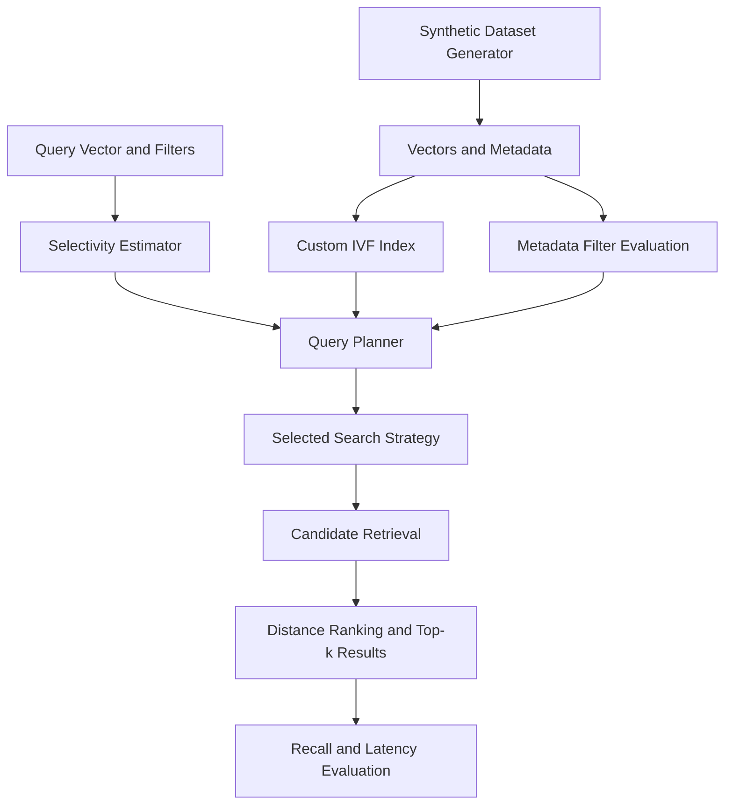

# The Madurai Pincode Search

## 1. Problem Summary

The Madurai Pincode Search project explores filtered vector search over a synthetic marketplace dataset containing vector embeddings and metadata.

The goal is to retrieve the nearest matching vectors while supporting metadata filters and balancing search quality with query latency.

The implementation supports these filters:

- Category equality
- Delivery-zone equality
- Minimum and maximum price conditions
- Combinations of filters using AND logic

The project uses a custom Inverted File (IVF)-style vector index and a query planner that selects a search strategy based on estimated filter selectivity.

The evaluation compares the planner with pre-filter and post-filter baselines using Recall@10 and latency measurements across different filter-selectivity buckets.

## 2. Architecture

The architecture consists of five main stages:

1. **Dataset generation:** Creates synthetic vectors and metadata using a fixed random seed.
2. **Index construction:** Organizes vectors into IVF-style partitions.
3. **Filter estimation:** Estimates how many records will match the requested metadata conditions.
4. **Query planning and retrieval:** Selects a search strategy and retrieves candidate vectors.
5. **Evaluation:** Ranks results by vector distance and measures recall and latency.

The architecture diagram is included in `docs/architecture.png`.




The planner uses estimated selectivity to choose a search path. The selected strategy applies metadata filtering and retrieves candidates, after which the results are ranked by vector distance. The benchmark compares the resulting recall and latency with the baseline methods.

## 3. Requirements and Setup

### Environment

The project was developed and tested in the following environment:

- Operating system: Windows
- Python: 3.13.11
- Git: 2.52.0.windows.1
- Numerical computation: NumPy

### Installation

Open PowerShell and navigate to the repository directory:

```powershell
cd path\to\horrazon-filtered-vector-search
```

Create and activate a virtual environment:

```powershell
python -m venv .venv
.\.venv\Scripts\Activate.ps1
python -m pip install --upgrade pip
```

Install the project dependencies:

```powershell
python -m pip install -r requirements.txt
```

Run the tests:

```powershell
python -m pytest -q
```

The latest recorded test run completed with **4 passing tests**.

## 4. Dataset

The project uses a synthetic dataset generated with a fixed random seed.

| Property | Value |
|---|---:|
| Original records | 30,000 |
| Vector dimensions | 32 |
| Categories | 20 |
| Delivery zones | Approximately 30 |
| Random seed | `20261023` |

Each record contains a vector and associated metadata. The generator introduces nonuniform distributions and relationships between some metadata fields and vector groups.

Prices are generated synthetically using category-dependent distributions. The fixed seed makes the original dataset reproducible when the same generation procedure and dependencies are used.

The dataset is intended to evaluate search behavior under different filter selectivities. It is synthetic and should not be treated as representative of every real-world marketplace workload.

## 5. Running the Project

Run these commands from the repository root.

### Run the demonstration

```powershell
python main.py demo
```

### Run the benchmark

```powershell
python main.py benchmark
```

### Run the mutation experiment

```powershell
python main.py mutation
```

### Run automated tests

```powershell
python -m pytest -q
```

The demo exercises the search workflow. The benchmark compares the planner with the baseline methods, while the mutation experiment evaluates behavior after the configured dataset changes.

Benchmark and mutation results are saved under the `results` directory.

## 6. Index and Query Planner

### Custom IVF-style index

The implementation organizes vectors into partitions around cluster centers. Instead of always comparing a query against every vector, the search process can examine selected partitions to retrieve candidate vectors.

The number of partitions examined affects the trade-off between retrieval cost and recall. Searching more partitions can improve the chance of finding the exact nearest neighbors but may increase the work performed per query.

### Search strategies

**Exact filtered search — `exact_filtered`**

Applies the metadata filters and performs exact distance ranking over the eligible records. This is intended for queries where the matching subset is sufficiently small.

**Partition prefilter — `partition_prefilter`**

Uses metadata filtering and eligible partitions to narrow the search space before ranking candidate vectors.

**IVF postfilter — `ivf_postfilter`**

Retrieves candidates from IVF partitions and applies the metadata filters to those candidates. Its effectiveness depends on the number and quality of candidates retrieved.

**Post-filter baseline — `postfilter`**

Retrieves vector candidates before applying metadata filters. This provides a comparison for filtering after candidate retrieval.

**Pre-filter baseline — `prefilter`**

Restricts the eligible records using metadata filters before vector ranking. This provides a comparison for filtering before ranking.

### Selectivity estimation

The selectivity estimator combines marginal selectivity estimates for the supported metadata predicates. The resulting estimate is used by the planner to choose a search strategy.

The configured thresholds are:

| Estimated selectivity | Selected strategy |
|---|---|
| At or below `0.002` | `exact_filtered` |
| Greater than `0.002` and at or below `0.08` | `partition_prefilter` |
| Greater than `0.08` | `ivf_postfilter` |

These thresholds are specific to this implementation and workload. They are not universal optimal values. Their effectiveness must be assessed using measured performance.

A limitation of multiplying marginal estimates is that the result can be inaccurate when metadata fields are correlated. For example, category and delivery zone may not be independent, so the estimated selectivity may differ from the actual proportion of matching records.

## 7. Benchmark Methodology

The benchmark evaluates five selectivity buckets:

- Approximately 100%
- Approximately 10%
- Approximately 1%
- Approximately 0.1%
- A handful of matching records

For each bucket, the planner is compared with the post-filter and pre-filter baselines.

**Recall@10** measures the overlap between the returned top-10 results and the exact ground-truth top-10 results under the benchmark's evaluation procedure.

**p50 latency** is the median measured query latency.

**p95 latency** is the latency below which 95% of the measured queries fall.

Latency is reported in milliseconds. The measurements represent the tested environment and query workload; they are not production performance guarantees.

The ground-truth calculation used for benchmark evaluation is separate from the timed search operation. The reported results should be interpreted in the context of the synthetic dataset and benchmark implementation.

## 8. Benchmark Results

The following measurements are from the latest recorded execution of `python main.py benchmark --n 30000`. Latency is reported in milliseconds.

| Bucket | Matches | Method | Recall@10 | p50 (ms) | p95 (ms) |
|---|---:|---|---:|---:|---:|
| ~100% | 30,000 | Planner | 1.000 | 3.619 | 5.079 |
| ~100% | 30,000 | Post-filter | 1.000 | 3.434 | 4.085 |
| ~100% | 30,000 | Pre-filter | 1.000 | 5.647 | 6.264 |
| ~10% | 3,000 | Planner | 0.999 | 0.480 | 0.764 |
| ~10% | 3,000 | Post-filter | 0.999 | 0.502 | 0.975 |
| ~10% | 3,000 | Pre-filter | 1.000 | 0.381 | 0.592 |
| ~1% | 301 | Planner | 1.000 | 0.319 | 0.538 |
| ~1% | 301 | Post-filter | 1.000 | 0.326 | 0.490 |
| ~1% | 301 | Pre-filter | 1.000 | 0.180 | 0.216 |
| ~0.1% | 30 | Planner | 1.000 | 0.094 | 0.102 |
| ~0.1% | 30 | Post-filter | 1.000 | 0.206 | 0.321 |
| ~0.1% | 30 | Pre-filter | 1.000 | 0.094 | 0.161 |
| Handful | 1 | Planner | 1.000 | 0.090 | 0.100 |
| Handful | 1 | Post-filter | 1.000 | 0.416 | 0.461 |
| Handful | 1 | Pre-filter | 1.000 | 0.090 | 0.097 |

### Observations

- The planner recorded Recall@10 of at least `0.999` across all five benchmark buckets in this run, meeting the `0.95` target.
- The planner selected different strategies according to the estimated filter selectivity.
- Latency varied with the number of matching records and the retrieval strategy.
- At approximately 10% selectivity, pre-filtering was faster than the planner in this run: p50 latency was `0.381 ms` compared with `0.480 ms`.
- At approximately 1% selectivity, pre-filtering was also faster: p50 latency was `0.180 ms` compared with `0.319 ms`.
- In the broad-filter bucket, the post-filter baseline was slightly faster than the planner in this run.

These measurements show that the configured planner does not always select the lowest-latency strategy. The results are from one execution and should not be treated as universal performance guarantees.

## 9. Partition-Probing Experiment

An additional experiment evaluated Recall@10 at different fractions of IVF partitions examined. The same 100 queries were used for each probing percentage.

| Partitions examined | Recall@10 |
|---:|---:|
| 15% | 0.9430 |
| 25% | 0.9850 |
| 50% | 1.0000 |
| 75% | 1.0000 |
| 100% | 1.0000 |

### Observations

- At 15% probing, Recall@10 was `0.9430`, below the `0.95` target.
- At 25% probing, Recall@10 increased to `0.9850`.
- At 50% probing and above, Recall@10 was `1.0000` on the evaluated workload.

These results demonstrate the recall trade-off associated with the number of partitions examined. The 25% setting was the lowest tested percentage to meet the target in this experiment. Latency was not measured by this diagnostic, so these results do not establish that 25% is the optimal operating point.

The diagnostic is implemented by `diagnose_nprobe()` in `main.py`. In the current CLI, this function is not exposed as a command. To reproduce the table, invoke the diagnostic using a temporary entry point, then restore the normal `main()` entry point before running the regular CLI commands.

## 10. Mutation Experiment

The mutation experiment evaluates how the search system behaves after changes to the dataset distribution.

### Mutations performed

- **Deletion:** Removed 759 items (approximately 10%) from the busiest zone, zone 0.
- **Insertion:** Added 1,500 new items, representing 5% of the original 30,000-item dataset.
- **Category shift:** New items use category `20`, outside the original category range of `0–19`.
- **Vector distribution shift:** New vectors are sampled from a normal distribution with mean `5.5` and standard deviation `1.0`, differing from the original dataset distribution.
- **Price distribution shift:** New prices are sampled from a log-normal distribution using `log(1800)` as the mean parameter and `0.5` as the standard deviation parameter. Prices are clipped to the range `99–12,000`.
- **Index and metadata updates:** After insertion, the IVF partitions and filter metadata are rebuilt to account for the changed dataset.

### Results after mutation

The following measurements are from the recorded execution of `python main.py mutation`. Latency is reported in milliseconds.

| Selectivity bucket | Matches | Method | Recall@10 | p50 (ms) | p95 (ms) |
|---|---:|---|---:|---:|---:|
| ~100% | 30,741 | Planner | 1.000 | 3.947 | 5.833 |
| ~100% | 30,741 | Post-filter | 1.000 | 8.390 | 12.349 |
| ~100% | 30,741 | Pre-filter | 1.000 | 6.912 | 14.548 |
| ~10% | 3,075 | Planner | 1.000 | 0.554 | 0.910 |
| ~10% | 3,075 | Post-filter | 1.000 | 0.575 | 1.103 |
| ~10% | 3,075 | Pre-filter | 1.000 | 0.407 | 0.707 |
| ~1% | 307 | Planner | 1.000 | 0.339 | 0.402 |
| ~1% | 307 | Post-filter | 1.000 | 0.428 | 0.680 |
| ~1% | 307 | Pre-filter | 1.000 | 0.215 | 0.343 |
| ~0.1% | 31 | Planner | 1.000 | 0.103 | 0.231 |
| ~0.1% | 31 | Post-filter | 0.973 | 0.284 | 0.682 |
| ~0.1% | 31 | Pre-filter | 1.000 | 0.103 | 0.168 |
| Handful | 1 | Planner | 1.000 | 0.120 | 0.235 |
| Handful | 1 | Post-filter | 1.000 | 0.507 | 1.111 |
| Handful | 1 | Pre-filter | 1.000 | 0.111 | 0.260 |

### Observations

- The planner achieved Recall@10 of `1.000` in all five selectivity buckets in this run.
- The post-filter baseline achieved Recall@10 of `0.973` in the approximately `0.1%` selectivity bucket and `1.000` in the other four buckets.
- The planner maintained the target Recall@10 of at least `0.95` across all five buckets in this experiment.
- At approximately `1%` selectivity, pre-filtering was faster than the planner: p50 latency was `0.215 ms` compared with `0.339 ms`.
- The measurements show that the planner's strategy does not always produce the lowest observed latency.

### Limitations

The experiment rebuilds the IVF partitions and filter metadata after insertion. It therefore evaluates search behavior after the configured dataset changes and the index is rebuilt, rather than measuring continuous incremental updates without rebuilding.

The reported latency values are measurements from one execution. They can vary with runtime conditions and should not be interpreted as guaranteed performance. Additional runs with different mutation seeds and query sets would be needed to evaluate consistency more thoroughly.

## 11. Measured Planner Limitation and Failure Case

A diagnostic was run using the fixed dataset seed (`20261023`), 30,000 vectors, and 100 query vectors. The filter used the 10th-percentile price threshold:

- Filter: `price_max = 275.4617`
- Matching records: 3,000
- Actual selectivity: 10%
- Estimated selectivity: 10%
- Planner-selected strategy: `ivf_postfilter`

All three strategies achieved Recall@10 of `1.0000` in each of the three recorded runs.

### Recorded p50 latency (ms)

| Run | Planner | Prefilter | Postfilter |
|---|---:|---:|---:|
| 1 | 1.082 | 0.779 | 0.771 |
| 2 | 0.952 | 0.803 | 0.880 |
| 3 | 2.091 | 2.120 | 2.769 |

### Recorded p95 latency (ms)

| Run | Planner | Prefilter | Postfilter |
|---|---:|---:|---:|
| 1 | 2.536 | 1.288 | 1.462 |
| 2 | 1.524 | 1.254 | 1.589 |
| 3 | 4.135 | 2.657 | 6.799 |

The planner selected `ivf_postfilter` for this 10%-selectivity query. Prefiltering had lower p50 latency in two of the three repeated runs, while the planner was slightly faster than prefiltering in the third run. All strategies achieved Recall@10 of `1.0000`.

This demonstrates that the fixed-threshold planner does not consistently choose the lowest-latency strategy on this workload. Timing varies between runs, so this should be treated as a measured limitation rather than a universal performance claim.

This diagnostic does **not** show that the selectivity estimate was wrong: the actual and estimated selectivity were both 10%. The observed limitation is the strategy choice and its measured performance for this workload. The current planner uses fixed selectivity thresholds and does not dynamically adapt those thresholds to runtime measurements.

### Reproduction

Run:

```powershell
python planner_diagnostic.py
```

The diagnostic uses the same query vectors for the planner, pre-filter, and post-filter comparisons within each run and reports actual selectivity, estimated selectivity, Recall@10, and latency. Latency is sensitive to runtime conditions, so repeated runs may produce different timings.

## 12. Testing

The latest recorded automated test command was:

```powershell
python -m pytest -q
```

The run completed with four passing tests:

```text
4 passed in 0.21s
```

## 13. AI-Use Disclosure

AI tools were used for research and to understand concepts related to the problem, including filtered vector search, query planning, and benchmarking. The implementation, testing, and benchmark results were checked against actual project execution.

## 14. Future Improvements

Possible areas for further improvement include:

- Improving selectivity estimation when metadata predicates are correlated.
- Calibrating strategy thresholds against more query distributions.
- Evaluating additional partition-probing policies.
- Testing repeated mutations with different random seeds.
- Comparing latency and recall across a wider range of filter combinations.
- Adding more tests for edge cases and planner decisions.
- Evaluating performance in a clean environment and documenting reproducible benchmark conditions.

These are potential future improvements and should not be interpreted as features already implemented or validated.
