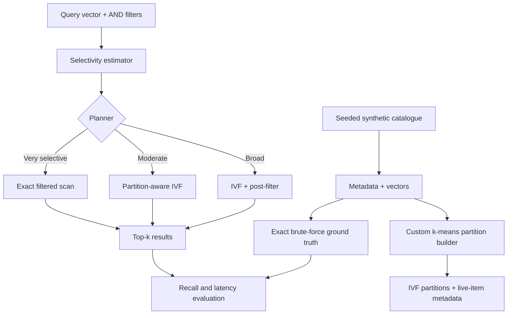

# Problem 1 — The Madurai Pincode Search

## Summary
This prototype compares an exact filtered scan, IVF-style approximate search with post-filtering, and partition-aware filtered search. It uses reproducible synthetic vectors because the assessment permits synthetic clustered vectors and a public-data download would consume the limited build budget.

## Architecture

## Setup
- Python 3.11+ recommended (tested locally with Python 3.13 where compatible).
- Create a virtual environment and install pinned dependencies:
  - Windows PowerShell: `py -m venv .venv; .\\.venv\\Scripts\\Activate.ps1; python -m pip install -r requirements.txt`
  - macOS/Linux: `python3 -m venv .venv && source .venv/bin/activate && python -m pip install -r requirements.txt`
- No API keys are required.

## Run
- Demo planner choices: `python main.py demo`
- Benchmark: `python main.py benchmark`
- Mutation: `python main.py mutation`
- Tests: `pytest -q`

The script saves result rows as JSON under `results/`. Benchmark timings vary by machine; regenerate them rather than copying example numbers.

## Dataset
The generator uses a fixed seed (`20261023`), 30,000 32-dimensional vectors, 20 categories, and 30 delivery zones with a skewed distribution. Category 0 is concentrated in zone 3 to model a regional category correlation. Prices are generated from category-dependent log-normal distributions. This is synthetic data, not real product or customer data.

## Strategies and trade-offs
- `exact_filtered`: scan only rows matching the filter, then compute exact distances. This should be attractive for tiny candidate sets and is the ground-truth method.
- `postfilter`: visit nearest IVF partitions, then discard rows that fail metadata filters. This can return too few matches if the nearest partitions contain few qualifying rows.
- `partition_prefilter`: first identify partitions with at least one matching live item, order those partitions by centroid distance, and search them. It avoids obviously irrelevant partitions but partition membership is only a coarse signal.
- `ivf_postfilter`: planner's broad-query strategy. The estimator uses marginal selectivities; it is intentionally simple and can badly estimate correlated conjunctions.

Initial planner thresholds are `0.2%` and `8%`. They are starting hypotheses, not universal constants. After benchmarking, adjust them using measured crossover points and explain the evidence. Do not claim a measured crossover until you have run the benchmark on your machine.

## Mutation
The mutation command deletes 10% of the busiest zone and adds 5% new items from a shifted vector/price distribution, then rebuilds partitions. Rebuilding is simple but costs time; a production index might use incremental insertion plus periodic retraining and recall monitoring. The synthetic generator has 20 categories, so the shift is represented by new distributional behaviour rather than a new metadata category.

## Known limitations
- Synthetic vectors do not capture real semantic search quality.
- The simple custom k-means implementation is for a small reproducible demonstration, not a production-scale clustering service.
- Selectivity estimates use marginal statistics and do not model all predicate correlations.
- Benchmark bucket filters are illustrative; inspect the printed `matches` counts. If a bucket is empty or does not land near its intended selectivity, update the filter specification and document the actual count rather than describing it as the target bucket.
- Approximate IVF recall depends on the partition count and probe policy. Verify the observed recall table before submission.

## AI-use note
Disclose the AI assistance actually used. For example: “I used an AI assistant to help scaffold and review parts of the implementation and README. I ran the code, inspected the results, and can explain the indexing, planner, evaluation, and limitations.” Edit this statement to match your real use and understanding.
